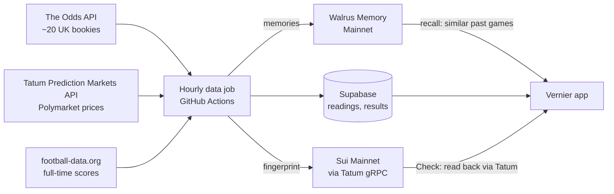

# Vernier


[](https://github.com/Maveri-Q/total-recall-hackathon/actions/workflows/tests.yml)
[](https://github.com/Maveri-Q/total-recall-hackathon/actions/workflows/data-job.yml)

**Bookies vs Polymarket before every big football game. It remembers who turned out right, and tells you who to trust next time.**

Built for the Total Recall hackathon (Tatum × Walrus), Track 1: Markets and Sports Prediction.

**Live app: https://vernier-odds.vercel.app** · No sign-up needed to look around.

---

## Judge quick start (60 seconds)

1. **Matches** (home): this week's games from 6 leagues. Each game shows the bookies' chances next to Polymarket's as two bars, with "Draw" under the draw.
2. **Make your call** on any game. The card opens a record built from **Walrus recall**: "When they disagreed like this before, Polymarket got closer in 7 of 10 Serie A games", and under it **the actual past games Walrus brought back**, each linking to its memory.
3. Tap a pick. Signed out, you get a sign-in card and nothing is saved. Signed in, your call is **stamped on Sui in about 2 seconds**, with a link to the transaction.
4. **Records**: the score so far by gap size and league, and **How this changed**: the record after each graded game, each step a Walrus memory saved that day.
5. **Proof**: tap **Check** on any stamp. The app reads it back from Sui Mainnet through Tatum, rebuilds the fingerprint from what we saved, and tells you if it matches and how long before kickoff it was stamped.

## Check our claims yourself

| We say | How to check it |
|---|---|
| Odds are recorded before kickoff and can't be changed after | Proof → **Check** on any stamp. Or open it on Suiscan and compare the `Stamped` event's time with kickoff. |
| Walrus remembers every reading, result and record | Proof → **Check** on any memory opens its blob on Walruscan. 68 memories and counting. |
| Walrus recall drives the advice | Open a game's record card: the games listed under "The games Walrus brought back" are the ones counted. |
| The app learns as games are played | Records → **How this changed**: Serie A went Polymarket 3-0, 5-1, 6-2, 7-2, 7-3, each step a Walrus memory. |
| It's all real data | Every number comes from The Odds API, Polymarket (via Tatum) or football-data.org. No demo or seeded data. |

## The problem

A bettor sees one bookie's odds and can't tell if the price is fair. Polymarket, where people trade real money on the same game, often gives a different chance. Nobody shows when the two disagree, or which one is usually right.

Vernier does, with no effort from the user. It's named after the vernier scale: two scales side by side, and you read where they line up. Here the two scales are the bookies and Polymarket.

It is **not** a betting site. No bets, no stakes, no payouts, no tips.

## How it works



Every hour, at :17 past (Supabase `pg_cron` starts the job on time; GitHub's own timer is the backup):

1. **List** this week's games in 6 leagues (a free call).
2. **Read the odds** for games due a reading: one day before kickoff, and 1 to 4 hours before. Bookie odds and Polymarket prices are fetched seconds apart. More than 5 minutes apart and the reading is marked "out of sync" and left out of scoring.
3. **Stamp** each reading's sha256 fingerprint on Sui Mainnet, through Tatum's gRPC gateway. Only the fingerprint goes onchain.
4. **Grade** finished games: the 90-minute score from football-data.org, then a Brier score for each source.
5. **Remember** it all on Walrus: each reading, each graded game, and each league's record every time it grows.
6. **Recall**: when a game is opened, Walrus brings back past games in the same league with a similar gap. The code counts who was closer.

**The database does the counting, Walrus does the remembering.** All maths is plain, tested code. Walrus picks which past games are similar. It never decides a number.

## How it uses Tatum, Sui and Walrus

| | What for | Where in the code |
|---|---|---|
| **Tatum Prediction Markets API** | Finds the Polymarket event for each game (both teams and the kickoff must agree, never a guess) and reads the Yes price of home, draw and away. | `src/lib/tatum.ts` (`findPolymarketMatch`, `fetchPolymarketPrices`) |
| **Tatum Sui gRPC gateway** | Every Sui call: sending stamp transactions, checking the app wallet's balance, and **reading stamps back** for "Check". | `src/lib/tatum.ts` (`stampHashes`, `getAppBalance`, `readStamps`) |
| **Sui Move module** | `stamp::record` emits a `Stamped` event: the fingerprint, the record id, Sui's own clock time and who sent it. | `move/sources/stamp.move` |
| **Walrus Memory (MemWal)** | Saves readings, results, league records and calls. Recalls similar past games for each record card. | `src/lib/walrus.ts`, `src/lib/data-job/remember.ts` |

**Stamping is fast and safe:** a call is stamped while you wait, in about 2 seconds (1.1s of it on Sui). A dropped connection to Tatum is retried with the *same signed transaction*, so a stamp can never be made twice.

## Mainnet proof

Checked 30 Oct 2026. Updated again right before submission.

| What | Value |
|---|---|
| Walrus memories saved on Mainnet | **68**: 30 odds readings, 10 graded games, 10 league records, 18 user calls |
| `MEMWAL_AGENT_ID` (Walrus Memory account ID) | `0xfdf452a10a829d4b5f7331a2a993b5ee088456717d9b6cd221b18dbf868f27b8` |
| Sui stamps | **50**: 30 odds readings and 20 user calls |
| Sui package (`stamp` Move module) | [`0xa4b3e8cc…df210237`](https://suiscan.xyz/mainnet/object/0xa4b3e8ccb8b9331838bb8257c4ec06d3ea7848b67c4cabde3248b7e6df210237) |
| App wallet that pays for stamps | [`0x6d7a28ce…e388f88f3a`](https://suiscan.xyz/mainnet/account/0x6d7a28ce3c59ebe4596e2d13ac7872b2ef9a828945bfd6cbad9df8e388f88f3a) |
| Games tracked / graded so far | 76 / 10 |
| Hourly data job runs | 83 |
| Walrus Memory dashboard | https://memory.walrus.xyz/dashboard |

Real stamps on Suiscan:
- [Le Havre v PSG, odds 3.7 hours before kickoff](https://suiscan.xyz/mainnet/tx/wBy8XnsUgeiyNKqnbzTtvMHEk42mfQ945C3q19epxQN) (30 Oct)
- [Villarreal v Espanyol, odds the day before](https://suiscan.xyz/mainnet/tx/Cd8yKFkf7b3pUXZ19612tGR6LuUoVe9959AGRVr97Wof) (29 Oct)
- [Frosinone v Lecce, odds 3.2 hours before kickoff](https://suiscan.xyz/mainnet/tx/CFjLWQ9KusznghbMfvTgm9vg6rwdgskvJRFLd9Dma7EA) (29 Oct)
- [Genoa v Juventus, odds 3.5 hours before kickoff](https://suiscan.xyz/mainnet/tx/7WNEaWHGHaWmfPXxYHaYsMMH1aTgFEJ8G3nBxTh5FZvN) (28 Oct)
- [A user's call](https://suiscan.xyz/mainnet/tx/KwfeUf2Y6BpCqueTWXFgnq9dkrfdqT6cCJHeUPfDU45) (30 Oct)

## The maths

All in `src/lib/odds.ts` and `src/lib/scoring.ts`, tested against sums worked out by hand.

- **Bookie odds to chance:** 1 ÷ decimal odds for each result, then scaled so the three add up to 100%. That removes the bookie's margin. With ~20 bookies, we take the median of each result, then scale again.
- **Polymarket to chance:** the Yes price of the home, draw and away markets, scaled to add up to 100%.
- **Thin markets don't count:** a Polymarket game with under $10,000 traded is saved but left out of scoring.
- **Who was closer: the Brier score.** For each source, add up (chance given − what happened)² over the three results. Lower is better.
  - *Example:* bookies Chelsea 48% / draw 27% / Man United 25%, Polymarket 60% / 22% / 18%, and Chelsea win.
  - Bookies: 0.52² + 0.27² + 0.25² = **0.406**. Polymarket: 0.40² + 0.22² + 0.18² = **0.241**. Polymarket was closer.
- **One vote per game:** the pre-kickoff reading if it's usable, otherwise the day-before one.
- **Gap size:** the biggest difference between the two on any result. Close is under 5 points, medium is 5 to 10, big is 10+. A game is compared with past games of the same size gap.

## Honest limits

- **It's early.** 10 graded games so far, all in Serie A, so every record says "early signal". This weekend's games across all 6 leagues add more. Small samples are always labelled, and every claim shows how many games it's based on.
- **A stamp proves when we recorded something,** not that every bettor could get that price, and not that a source is trustworthy.
- **Our first 11 readings were stamped late** (27 Oct, before stamping went live). Check says so plainly. Every reading since is stamped before kickoff.
- **One app wallet pays for every stamp** (below). Users don't sign anything, so a call's stamp proves *the app* recorded it at that time.
- **Walrus Memory's relayer sees the text it saves.** We only save public match data, and calls carry an anonymous fan id: never a name or an email.

## The app wallet

Users never need a wallet or SUI. One app wallet, held server-side, pays the gas for every stamp:

- **Cost:** about 0.0001 SUI per transaction. One transaction can stamp up to 100 readings. A month of stamping costs well under 0.01 SUI.
- **Key safety:** the key lives only in the server's environment variables (`.env.local` and the GitHub and Vercel secrets). It's never in the code or the browser.
- **Low balance:** under 0.5 SUI, the hourly job writes a warning to its log.
- **No spamming:** each user can make at most 30 calls a day (enforced by the database), and calls lock at kickoff.

## Run it yourself

You need Node 24, and free accounts with Supabase, Tatum, The Odds API, football-data.org and Walrus Memory.

1. **Get the code:**
   ```bash
   git clone https://github.com/Maveri-Q/total-recall-hackathon.git && cd total-recall-hackathon && npm ci
   ```
2. **Keys:** copy `.env.example` to `.env.local` and fill it in. Each line says where the value comes from.
3. **Database:** in the Supabase SQL Editor, run each file in `supabase/migrations/` in number order (0001 to 0010).
4. **Sui (optional, for stamping):** `npx tsx scripts/create-app-wallet.mts` makes the app wallet and saves its key into `.env.local` (only the address is printed). Send it a little SUI, then `npx tsx scripts/publish-move.mts` publishes the Move module and saves the package id into `.env.local`. The compiled module is already in `move/bytecode.json`, so you don't need the Sui CLI.
5. **Fill it with data:**
   ```bash
   npx tsx scripts/sync-teams.mts
   ```
   ```bash
   npm run data-job
   ```
   The first syncs club names, crests and colours. The second runs the hourly job once.
6. **Start the app:**
   ```bash
   npm run dev
   ```
   Then open http://localhost:3000.

**Helper scripts** (`scripts/`): `check-walrus.mts` tests the Walrus keys, `recall-demo.mts` shows what Walrus recalls for upcoming games, and `check-sui.mts` tests the Sui connection.

## Where things live

| Path | What |
|---|---|
| `src/lib/tatum.ts` | Every Tatum call: Prediction Markets API and Sui gRPC |
| `src/lib/walrus.ts` | Every Walrus Memory call |
| `src/lib/odds.ts`, `src/lib/scoring.ts` | The maths |
| `src/lib/data-job/` | The hourly job: readings, stamps, grading, memories |
| `src/lib/stamp-check.ts`, `src/lib/check-stamp.ts` | "Check this stamp" |
| `move/sources/stamp.move` | The Sui Move module |
| `supabase/migrations/` | The database, one numbered file per change |
| `.github/workflows/` | The hourly data job, and the checks on every push |

## Tests

Every push runs three checks on GitHub (the first badge): **types, lint, then 163 tests**.

- **The maths:** odds to chances, Brier scores, grading, the reading schedule, team-name matching, memory texts, the record history.
- **Stamps:** fingerprints rebuilt from saved rows match the ones stamped (checked against every real stamp on 30 Oct: 30 of 30 readings, 20 of 20 calls). Editing one bookie price after stamping is caught.
- **When things go wrong:** the hourly job runs against stand-ins for every outside service, and each one is broken in turn (`src/lib/data-job/run.test.ts`, `remember.test.ts`):
  - **Tatum down:** no half reading is saved, and the next run tries again.
  - **Odds API limit hit, or credits running low:** that league waits, and the rest of the run carries on.
  - **No Polymarket market:** the bookie odds are kept, marked "not for scoring", never matched to a guess.
  - **Sui transaction fails:** the readings are marked failed and stamped next run.
  - **App wallet low:** a warning in the job log.
  - **Walrus down, or a save fails:** the memory stays queued and is sent next run.
  - **Match postponed:** noted, never graded.
  - **Team names don't match:** no result is guessed.

## Built with

Next.js 16 (TypeScript), Supabase (Postgres and sign-in with Google or email), Tatum (Prediction Markets API and Sui gRPC), Sui Move, Walrus Memory (`@mysten-incubation/memwal`), The Odds API, football-data.org, GitHub Actions and Vercel.

## Credits

Club crests belong to their clubs and are shown only to identify teams. Vernier isn't linked to any club, league, bookmaker or Polymarket.
